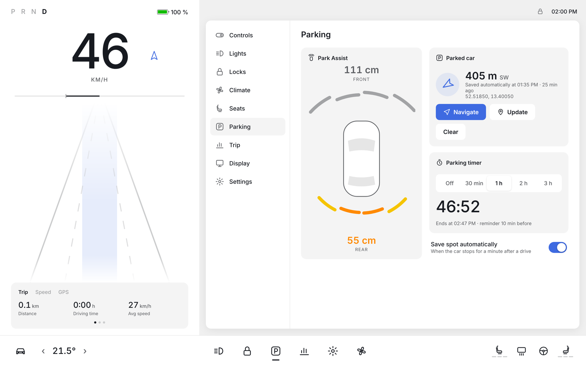
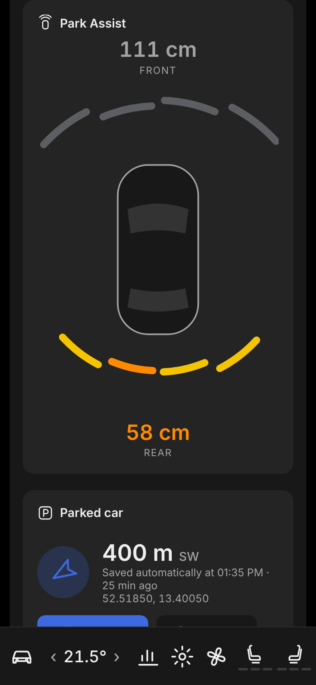

# Digital Dashboard

A Tesla-style digital dashboard built with **Ionic + Angular + Capacitor**. It shows your live speed from the phone's GPS, together with climate and car controls in the layout of Tesla's latest UI. It works on tablets (landscape) and phones (portrait), in light and dark mode.

| Tablet – light | Climate pop-up – dark |
| --- | --- |
|  |  |

| Parking | Settings |
| --- | --- |
|  |  |

| Phone | Phone – climate | Phone – park assist |
| --- | --- | --- |
|  |  |  |

## Features

- **Speed**: large live speed from GPS (km/h or mph), with a power/regen bar driven by acceleration and moving lane lines.
- **Speed limit**: looked up from OpenStreetMap; the sign pulses when you are over the limit.
- **Trip card**: distance, driving time, average and max speed, heading, plus GPS accuracy and altitude. The trip is saved between launches and can be reset.
- **Climate**: driver and passenger temperature, Auto, a 10-step fan, A/C, recirculation, face/feet airflow, front and rear defrost, 3-level seat heaters and steering wheel heat. Tap the temperature in the bottom bar to open the pop-up.
- **Controls**: headlights (Off/Parking/On/Auto), fog lights, mirrors, child and window locks, glovebox, door lock, frunk, trunk, wipers and steering mode.
- **Parking**:
  - **Park Assist**: Tesla-style distance arcs around the car for front and rear sensors. They turn yellow, orange and red as you get closer, with STOP under 30 cm. Readings come from the vehicle link; demo mode simulates them.
  - **Find my car**: the spot is saved automatically when the car stops for a minute after a drive, or saved by hand. The app shows the distance and direction back to the car, with walking directions via *Navigate*.
  - **Parking timer**: choose 30 min, 1 h, 2 h or 3 h for a countdown. A phone notification arrives 10 minutes before the time is up, and again when it runs out.
- **Bottom bar** in Tesla's layout: car, temperature ‹ ›, shortcuts, seat heaters, rear defrost and wheel heat.
- **Settings**: units, light/dark/auto appearance, keep the screen on, demo mode, and on/off switches for the speed-limit and weather lookups.
- **Demo mode**: simulated driving, so you can try the app at your desk. It is offered automatically if GPS is denied or unavailable.

> **About the car controls:** out of the box, climate and control buttons only keep their state in the app; they don't talk to the car (see *Connecting a real car* below).
> Gear (P/D) is inferred from movement, and the battery shows the phone/tablet battery, unless a vehicle link provides real values.

## Getting started

Requirements: Node.js 20.19+ or 22.12+, plus Android Studio (Android) or Xcode (iOS) for device builds.

```bash
npm install
npm start            # dev server at http://localhost:4200
```

In a desktop browser, allow location access or switch on **Settings → Demo mode**.

### Run on Android

```bash
npm run android      # builds, syncs and opens Android Studio
```

Then press **Run** in Android Studio. Location permissions are already in `android/app/src/main/AndroidManifest.xml`.

### Run on iOS

```bash
npx cap add ios
```

Then add these keys to `ios/App/App/Info.plist`:

```xml
<key>NSLocationWhenInUseUsageDescription</key>
<string>Used to show your speed and trip.</string>
```

Then run:

```bash
npm run ios
```

## Project structure

```
src/app/
├── app.ts / app.html              # layout: car card | controls window, climate sheet, dock
├── components/                    # each component = .ts (logic) + .html (template)
│   ├── car-card.component.*       # gear, battery, speed, power bar, trip card
│   ├── controls-window.component.*   # Tesla "Controls" window with side menu
│   ├── climate-panel.component.*  # climate controls (sheet + Climate section)
│   ├── parking-panel.component.*  # park assist, find my car, parking timer
│   ├── dock.component.*           # bottom bar
│   └── icon.component.*           # icons from the SVG sprite in index.html
└── services/
    ├── drive.service.ts           # GPS speed, heading, trip, demo simulator
    ├── environment.service.ts     # clock, battery, outside temp, speed limit
    ├── parking.service.ts         # parked spot, parking timer + reminders, park-assist data
    ├── vehicle.service.ts         # climate/controls state + VehicleLink interface
    ├── settings.service.ts        # units, theme, demo, keep-awake
    └── ui.service.ts              # active section, climate sheet
src/styles.scss                    # all styles (Tesla design tokens, light/dark)
```

## Connecting a real car

Every button goes through `VehicleService`, which sends a `VehicleCommand` to a `VehicleLink`, for example:

```ts
{ kind: 'climate', key: 'driverC', value: 22 }
```

The default `DemoVehicleLink` only logs the commands. To control real hardware (such as an ESP32 or Arduino over Bluetooth LE, or an OBD adapter), implement `VehicleLink` and provide it in `src/app/app.config.ts`:

```ts
{ provide: VEHICLE_LINK, useClass: MyBleVehicleLink }
```

A link can also expose `batteryPercent()`, `gear()` and `parkSensors()` so the dashboard shows real car data. `parkSensors()` returns front and rear distances in cm, left to right, with `null` meaning nothing in range.

## Data sources

- Speed and position: device GPS via `@capacitor/geolocation`
- Speed limits: [OpenStreetMap Overpass API](https://overpass-api.de) (`maxspeed` tag)
- Outside temperature: [Open-Meteo](https://open-meteo.com) (free, no API key)

Both lookups can be switched off in Settings.
